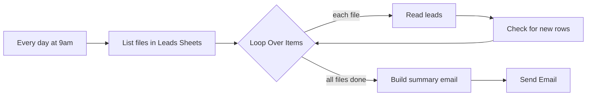

# Leads Notification (n8n + Google Drive)

An n8n workflow that emails you one daily summary of your new leads, across every Google Sheet in a Drive folder.

It runs every morning at 9AM, reads each sheet in the folder, finds the rows added since the last run, and sends them in a single email. If nothing new came in, no email is sent.

**The useful part: you never edit the workflow to track a new sheet.** Drop a new spreadsheet in the folder and the next run picks it up. I keep one lead sheet per [YouTube video](https://www.youtube.com/@viniciuscoutinhoai), so each new video's leads show up in the same email without touching n8n.

## The email

**Subject:** `New leads today: 3`

- **Leads - Video 16**: Maria Garcia, maria@example.com, filled at 2026-01-15T22:14:05.120-03:00
- **Leads - Video 16**: David Brown, david@example.com, filled at 2026-01-15T18:02:41.306-03:00
- **Leads - Video 14**: Emily Chen, emily@example.com, filled at 2026-01-15T11:37:52.874-03:00

*(Sample data.)* The bold label is the spreadsheet's file name, so you can see which source each lead came from.

## How it works



| Node | Type | What it does |
|---|---|---|
| **Every day at 9am** | Schedule Trigger | Starts the run |
| **List files in Leads Sheets** | Google Drive | Lists every file in the folder |
| **Loop Over Items** | Loop | Handles one file at a time |
| **Read leads** | Google Sheets | Reads the rows of the file. If a file can't be read, the run continues |
| **Check for new rows** | Code | Compares the row count with the last run and queues the new rows |
| **Build summary email** | Code | Turns the queue into an HTML list and empties the queue. Stops here if there are no new leads |
| **Send Email** | Gmail | Sends the summary |

### How it knows what's new

There's no extra database and no "notified" column in your sheets. The workflow uses n8n's [static data](https://docs.n8n.io/code/cookbook/builtin/get-workflow-static-data/) to remember one number per file: how many rows it had last time.

```
Last run: 12 rows    Today: 14 rows    Rows 13 and 14 go in the email
```

Your sheets are only read, never changed.

## Setup

You need an n8n instance (Cloud or self-hosted) and a Google account. The workflow uses no AI model and no paid API.

### 1. Prepare the Drive folder

Create a folder in Google Drive and put your lead spreadsheets in it. In each one, the leads go in the first tab, with these column headers:

| Column | Meaning |
|---|---|
| `Nome` | Lead's name |
| `Email` | Lead's email |
| `Horário de Preenchimento` | When the lead was submitted |

The names are in Portuguese because that's what my forms write. If yours are different (`Name`, `Submitted at`), change them in the two Code nodes: **Check for new rows** uses `Nome` and `Email`, and **Build summary email** uses all three.

### 2. Import the workflow

Open [workflow/leads_notification_folder_scan.json](workflow/leads_notification_folder_scan.json), copy everything, and paste it onto an empty n8n canvas (Ctrl+V).

### 3. Fill in your details

| Node | What to set |
|---|---|
| **List files in Leads Sheets** | Google Drive credential, and pick your folder (it says `YOUR_GOOGLE_DRIVE_FOLDER_ID`) |
| **Read leads** | Google Sheets credential |
| **Send Email** | Gmail credential, and your address in **To** (it says `YOUR_EMAIL@example.com`) |

### 4. Publish it

Activate the workflow. It has to be active to work properly, see the first two points below.

## Good to know

- **The first run emails every existing lead.** The workflow starts with no memory, so all rows count as new. After that first email, you only get new ones.
- **Manual tests don't save memory.** n8n only saves static data on production runs. If you click *Execute workflow*, every row looks new each time and you get the full list by email. Point it at a sheet with a couple of test rows while you try it.
- **Timezone.** 9AM follows your n8n timezone. Change it under *Workflow settings*. To change the time, edit **Every day at 9am**.
- **Only the folder itself is scanned.** Subfolders are ignored. Other file types in the folder don't break the run, they just add no leads.
- **The date is shown as stored.** You see the raw value from the sheet, as in the sample above. To format it, edit **Build summary email**.

## Known limitations

The workflow counts rows and doesn't track each lead, which keeps it simple. The trade-offs:

- **Deleting rows can hide a new lead.** With 3 rows saved, if you delete 2 and 1 new lead arrives, the sheet has 2 rows. The count didn't go up, so no alert goes out for that lead. Move old leads out only if you're fine with that, or delete them right after a run.
- **A failed read can send a sheet again.** If Google fails while reading a sheet, the run continues with that sheet's count at 0. The next successful run sends all of its rows again as new. You get duplicates, but no lost leads.
- **A failed email can lose that day's list.** The queue is emptied before the email goes out. If Gmail fails, those leads may not be sent again. They're still in your sheets, and n8n's execution log shows the failure, so turn on an error workflow if this matters to you.
- **Lead text isn't escaped.** Name and email go into the email's HTML exactly as submitted. It only goes to your own inbox, but anyone who can fill out your form controls that text, so be careful with links in it.

## Tests

The test runs the real code from the workflow file against fake sheets, with no n8n or Google account needed:

```bash
node tests/test_workflow.js
```

It covers new row detection, multiple sheets, the no-email case and the limitations above. It also checks that the published file has no real emails, credential IDs or Drive links.

## Related

- [youtube-weekly-report-n8n](https://github.com/viniciusccouti/youtube-weekly-report-n8n): a weekly YouTube channel report by email, with analysis written by Claude
- [My YouTube channel](https://www.youtube.com/@viniciuscoutinhoai): n8n automation tutorials
